# Level 2: flat package

## What this level teaches

Level 1's `main.go` split into one file per concern. The code is the same, line for line.
It is still a single `package main`, so this only helps you find your way around: the handlers,
the domain rules and each database now have their own file. Each store method still owns its
transaction and the whole business flow inside it.



## Folder tree

```
level-02-flat/
  main.go                     config from env, openStore (manual DI), router.Run
  todo.go                     Todo/Activity/Patch types, sentinel errors, nowUTC/newID, validation, applyPatch
  store.go                    the store interface
  store_postgres.go           postgresStore (GORM, AutoMigrate), findTodo, todoInUTC
  store_mongo.go              mongoStore (driver v2), creates collections + index at startup
  handler.go                  Gin router and handlers, todoID, parsePage, writeError
  todo_test.go                table tests for validateTitle, validatePatch, applyPatch
  handler_test.go             handler tests through the real router, with a hand-written in-memory fake store
  store_integration_test.go   one contract suite run against Postgres and Mongo in testcontainers (build tag `integration`)
  go.mod / go.sum             independent module example.com/todo/level02
  README.md                   this file
```

## Request flow

`PATCH /todos/:id` with `{"title":"new","completed":true}`:

1. **handler.go** `newRouter` routes the request to `handler.updateTodo`.
2. **handler.go** `updateTodo` calls `todoID` (a malformed UUID becomes `ErrNotFound`), binds the JSON into a `Patch`,
   then calls **todo.go** `validatePatch`, which trims the title and rejects an empty patch.
3. It calls `h.store.Update(ctx, id, patch)`. The handler only knows the `store` interface from **store.go**.
4. **store_postgres.go** `postgresStore.Update` (or **store_mongo.go** `mongoStore.Update`) opens a transaction,
   reads the current todo inside it, and calls **todo.go** `applyPatch`. That shared function changes the todo and
   returns one `Activity` per real change (`renamed`, then `completed`). The store saves the todo, inserts the
   activities, and commits.
5. Back in **handler.go**, success writes `200` with the todo. Any error goes to `writeError`, the one place that
   maps `ErrNotFound` to 404, validation errors to 400, and everything else to a logged 500.

## Where the transaction lives

Inside each store method, exactly as in level 1. Each store has a tiny `inTx` helper, and `applyPatch` holds the shared rule:

```go
// store_postgres.go
func (s *postgresStore) Update(ctx context.Context, id string, p Patch) (Todo, error) {
	var t Todo
	err := s.inTx(ctx, func(tx *gorm.DB) error { // BEGIN
		var err error
		t, err = findTodo(tx.Clauses(clause.Locking{Strength: clause.LockingStrengthUpdate}), id)
		if err != nil {
			return err // ROLLBACK
		}
		activities := applyPatch(&t, p, nowUTC())
		if len(activities) == 0 {
			return nil
		}
		if err := tx.Save(&t).Error; err != nil {
			return fmt.Errorf("update todo: %w", err)
		}
		if err := tx.Create(&activities).Error; err != nil {
			return fmt.Errorf("insert activities: %w", err)
		}
		return nil // COMMIT
	})
	...
}
```

Mongo does the same with a session. Every collection call must use the `ctx` that `WithTransaction` passes in,
because that ctx carries the session:

```go
// store_mongo.go
func (s *mongoStore) inTx(ctx context.Context, fn func(ctx context.Context) error) error {
	session, err := s.client.StartSession()
	...
	_, err = session.WithTransaction(ctx, func(ctx context.Context) (any, error) {
		return nil, fn(ctx)
	})
	return err
}
```

`SELECT ... FOR UPDATE` stops two concurrent PATCHes from both logging `completed`.
Mongo gets the same safety from write conflicts: `WithTransaction` reruns `fn` when another transaction got there first.

## What changed from the previous level

Level 1 had all of this in one `main.go`, in sections marked `// --- domain ---`, `// --- storage: postgres ---`
and so on. Level 2 turns each section into its own file, and splits the tests the same way. **Nothing else changed:**
identifiers, function bodies, comments, behaviour and tests are identical. Only the file headers, the import
lists, the default port (`:8082`) and the database name (`todo_l02`) differ.

That is also why this is still not an architecture. The files are a convention, not a boundary:

- It is one package, so every file sees everything. Nothing stops `handler.go` from calling GORM directly,
  or a store from writing an HTTP response.
- The store still owns the business flow *and* the transaction. "Read the todo, apply the patch, save it, log
  activities" is still written once per database, and the fake store in `handler_test.go` copies it a third time.
- One `Todo` type still carries `json`, `gorm` and `bson` tags.

Level 3 fixes the second point: it moves the flow and the transaction into a service layer in its own package.

## Pros / cons / when to use this in real life

**Pros**
- Easy to navigate: the file name tells you where to look, and each file is short.
- Still nothing new to learn: no packages, no imports between your own code, no layers.
- Changes touch smaller files, so diffs are easier to read and there are fewer merge conflicts on a team.

**Cons**
- Splitting files does not separate anything. All the coupling from level 1 is still there, just spread out.
- Adding a rule such as "notify on complete" still means editing both stores (and the fake).
- The business flow around `applyPatch` (not found, no-op patch, which activities get saved) can only be
  tested against a real database or a fake that copies it.

**When to use it:** small services, CLIs and internal tools that one or two people maintain, where the whole app
fits in your head. Once the stores start repeating business logic, or you want to test that logic without a
database, move it out of the store. That is level 3.

## Run & test

From this directory, with `docker compose up -d` already running at the repo root:

```sh
export PATH=$HOME/.local/go/bin:$HOME/go/bin:$PATH

# run (http://localhost:8082)
DB_DRIVER=postgres go run .
DB_DRIVER=mongo go run .

# unit tests (no Docker)
go test ./...

# integration tests (start their own Postgres and Mongo containers)
go test -tags=integration ./...

# smoke test: start the app with either driver, then from the repo root
python3 scripts/smoke.py http://localhost:8082
```

Config (all optional): `DB_DRIVER` (`postgres` or `mongo`), `POSTGRES_DSN`, `MONGO_URI`, `MONGO_DB` (default `todo_l02`),
`HTTP_ADDR` (default `:8082`). Set `GIN_MODE=release` to silence Gin's debug lines.
