# Level 4: package by feature

## What this level teaches

The code from level 3 (handler, service, repository) is regrouped by **business feature** instead of by
technical layer. Everything about todos lives in `internal/todo`, and everything about the activity log
lives in `internal/activity`. The two features talk through a tiny interface that the *consumer* declares
(`todo.ActivityRecorder`), so `activity` never imports `todo` and `main` wires them together.
One transaction still spans both features: the todo service opens it, and the repositories of both
features join it through the context.



## Folder tree

```
level-04-by-feature/
  cmd/api/main.go                 config from env, open DB, run each feature's migration, wire by hand, graceful shutdown
  internal/
    todo/                         the todo feature, all layers in one folder
      todo.go                     Todo, Patch, Action, New, ValidatePatch, Apply, domain errors (no tags)
      service.go                  Service (Create/Get/List/Update/Delete); declares TxManager and ActivityRecorder
      repository.go               Repository interface (Create/Get/GetForUpdate/List/Update/Delete)
      postgres.go                 todoRow + mappers, PostgresRepository, MigratePostgres
      mongo.go                    todoDoc + mappers, MongoRepository, MigrateMongo
      handler.go                  request/response DTOs, /todos routes, id + limit/offset parsing, writeError
      todo_test.go                New, ValidatePatch, Apply
      service_test.go             orchestration against fakes: same tx, same timestamp, validate-before-tx, recorder failure
      handler_test.go             HTTP tests with httptest
      fakes_test.go               hand-written fakes: repo, tx, activity recorder
      integration_test.go         contract + cross-feature commit/rollback on Postgres and Mongo (tag: integration)
    activity/                     the activity feature; knows nothing about todo
      activity.go                 Activity, New (no tags)
      service.go                  Service: Record (joins the caller's tx) and List
      repository.go               Repository interface (Create/ListByTodo)
      postgres.go                 activityRow + mappers, PostgresRepository, MigratePostgres (table + todo_id index)
      mongo.go                    activityDoc + mappers, MongoRepository, MigrateMongo (collection + todo_id index)
      handler.go                  DTOs, GET /todos/:id/activities, writeError
      *_test.go                   unit, handler and integration tests, same pattern as todo
    platform/                     shared infrastructure only, no business code
      database/                   OpenPostgres, OpenMongo, EnsureCollection
      tx/                         PostgresManager, MongoManager, Conn(ctx, db)
      httpx/                      RequestLogger (one zerolog line per request), InternalError (log it, answer 500)
      testdb/                     testcontainers setup that both features' integration tests share
  Taskfile.yml                    run:pg, run:mongo, test, test:integration, lint
```

## Request flow: `PATCH /todos/:id`

1. `cmd/api/main.go` built the router (`gin.New()` + `gin.Recovery()` + `httpx.RequestLogger`) and
   registered `todo.Handler` and `activity.Handler` on it.
2. `internal/todo/handler.go` `updateTodo` parses `:id` with `uuid.Parse` (malformed → `ErrNotFound`, 404)
   and binds `{"title"?, "completed"?}` into a `todo.Patch` (bad JSON → 400).
3. `internal/todo/service.go` `Update` calls `ValidatePatch` from `todo.go` **before** touching the
   database. An empty patch or a bad title is a 400, even for an unknown id. Then it calls `tx.WithinTx`.
4. `internal/platform/tx/postgres.go` (or `mongo.go`) starts the transaction and puts it in `ctx`.
5. Inside the transaction, `GetForUpdate` in `internal/todo/postgres.go` gets the transaction via
   `tx.Conn(ctx, r.db)` and runs `SELECT … FOR UPDATE`. On Mongo the session already rides in `ctx`.
6. `todo.go` `Apply(patch, now)` only diffs, and returns e.g. `[renamed completed]`.
7. `repo.Update` writes the todo. Then `record` calls `activities.Record(ctx, id, action, now)` for each
   action. That is `internal/activity/service.go`, reached through the `todo.ActivityRecorder` interface.
   It writes through `internal/activity/postgres.go`, which joins **the same** transaction via
   `tx.Conn`. Every activity gets the same `now` as the todo's `updated_at`.
8. `fn` returns nil → commit. Any error → rollback, and `writeError` in `handler.go` maps it to
   400/404/500.

## Where the transaction lives

The transaction is opened in the todo service, around writes that belong to two features:

```go
// internal/todo/service.go
patch, err := ValidatePatch(patch) // input checked before any database call
...
err = s.tx.WithinTx(ctx, func(ctx context.Context) error {
	todo, err = s.todos.GetForUpdate(ctx, id)
	...
	now := nowUTC()
	actions := todo.Apply(patch, now)
	if len(actions) == 0 {
		return nil // nothing changed, so nothing to write
	}
	if err := s.todos.Update(ctx, todo); err != nil {
		return err
	}
	return s.record(ctx, todo.ID, now, actions...) // other feature, same tx
})
```

The mechanism lives in `platform/tx`, so both features can use it without importing each other:

```go
// internal/platform/tx/postgres.go
func (m *PostgresManager) WithinTx(ctx context.Context, fn func(ctx context.Context) error) error {
	return m.db.WithContext(ctx).Transaction(func(tx *gorm.DB) error {
		return fn(context.WithValue(ctx, txKey{}, tx))
	})
}

// Every Postgres repository, in either feature, starts its queries here.
func Conn(ctx context.Context, db *gorm.DB) *gorm.DB {
	if tx, ok := ctx.Value(txKey{}).(*gorm.DB); ok {
		return tx
	}
	return db.WithContext(ctx)
}
```

For Mongo, `MongoManager.WithinTx` wraps `session.WithTransaction`. The ctx it hands to `fn` already
carries the session, so Mongo repositories need no helper.

## What changed from level 3

The layers and the code are the same, sliced by feature instead of by layer:

```
level 3 (by layer)                              level 4 (by feature)
internal/                                       internal/
  model/todo.go                          ->       todo/todo.go
  model/errors.go                        ->       todo/todo.go (domain errors)
  model/activity.go                      ->       activity/activity.go   (Action type stays in todo)
  service/todo_service.go                ->       todo/service.go        (+ ActivityRecorder, TxManager)
                                                  activity/service.go    (new: Record, List)
  repository/repository.go               ->       todo/repository.go, activity/repository.go
  repository/postgres/todo_repository.go ->       todo/postgres.go
  repository/postgres/activity_repo...   ->       activity/postgres.go
  repository/mongo/todo_repository.go    ->       todo/mongo.go
  repository/mongo/activity_repo...      ->       activity/mongo.go
  repository/postgres/db.go              ->       platform/database/postgres.go (Open) + platform/tx/postgres.go
  repository/mongo/db.go                 ->       platform/database/mongo.go (Open) + platform/tx/mongo.go
  handler/todo_handler.go, dto.go        ->       todo/handler.go
  handler/ (listActivities)              ->       activity/handler.go
  handler/errors.go                      ->       writeError in each handler.go + platform/httpx
  handler/router.go (requestLogger)      ->       platform/httpx.RequestLogger, routes in cmd/api/main.go
  repository/fake/fake.go                ->       fakes_test.go in each feature
  repository/repotest/repotest.go        ->       integration_test.go in each feature + platform/testdb
```

* **Cohesion.** A change to "todo" touches one folder. Deleting a feature means deleting a folder
  (plus its lines in `main.go`).
* **Activity is now a feature** with its own service and handler. In level 3 the todo service wrote
  to `repository.ActivityRepository` directly.
* **Consumer-side interface.** `todo/service.go` declares only what it needs:
  `ActivityRecorder { Record(ctx, todoID, action string, at time.Time) error }`. `*activity.Service`
  satisfies it implicitly (Go interfaces need no `implements`), `main.go` passes one into the other,
  and tests use a small hand-written fake. Dependencies point one way only: `main → todo`,
  `main → activity`, and never `activity → todo`. `at` is passed in so the activity's `created_at` equals
  the todo's `updated_at`.
* **Shared infrastructure moves to `platform`.** Each level 3 adapter package had its own `TxManager`
  and a private `conn`. Both features need them now, so they live in `platform/tx` and `conn` becomes
  the exported `tx.Conn`. There is no `shared`/`common`/`utils` package: `platform` holds
  infrastructure only.
* **Each feature migrates itself** (`todo.MigratePostgres`, `activity.MigrateMongo`, ...) instead of
  one `Migrate` per database.
* **The activity route's 404.** `activity/handler.go` has its own `errNotFound` with the message
  `todo not found`, because it must not import `todo.ErrNotFound`.
* **Renames forced by the package name** (to avoid stutter): `model.NewTodo` → `todo.New`,
  `model.NewActivity` → `activity.New`, `service.TodoService` → `todo.Service`,
  `repository.TodoRepository` → `todo.Repository`, `postgres.TodoRepository` →
  `todo.PostgresRepository`, `postgres.TxManager` → `tx.PostgresManager`, `requestLogger` →
  `httpx.RequestLogger` (exported, shared), `toModel` → `toTodo` / `toActivity`.
  Everything else keeps its level 3 name and shape: `Patch`, `ValidatePatch`, `Apply`,
  `GetForUpdate`, `ListByTodo`, `WithinTx`, `nowUTC`, `writeError`.

## Pros / cons / when to use this in real life

Pros
* Code that changes together sits together. A feature folder is easy to read, review, own and delete.
* Package names become the domain vocabulary (`todo.Service`, `activity.Record`) instead of
  `service.TodoService`.
* Consumer-side interfaces keep features decoupled and make fakes trivial.

Cons
* Features still share one database and one transaction, so they cannot be deployed separately.
* Cross-feature calls need discipline: if two features call each other, you get an import cycle and
  must turn one side around with an interface.
* Inside a feature folder the layers are just files, so nothing stops a handler from reaching into SQL.

When to use it: most small and medium Go services, once there is more than one business concept.
Move to clean/hexagonal (levels 5 and 6) when the domain must be strictly isolated from frameworks.
Move to a modular monolith (level 9) when features need their own data and transactions.

## Run & test

```sh
export PATH=$HOME/.local/go/bin:$HOME/go/bin:$PATH
docker compose up -d                 # once, at repo root

task run:pg                          # DB_DRIVER=postgres go run ./cmd/api   (:8084)
task run:mongo                       # DB_DRIVER=mongo    go run ./cmd/api   (:8084)
GIN_MODE=release task run:pg         # same, without Gin's debug lines

task test                            # go test ./...                      unit tests, no Docker
task test:integration                # go test -tags=integration ./...    testcontainers, both DBs + rollback
task lint                            # gofmt -l, go vet (both build tags)

# smoke test, from repo root, with the app running on either driver
python3 scripts/smoke.py http://localhost:8084
```

Config (env): `DB_DRIVER` (`postgres`|`mongo`), `POSTGRES_DSN`, `MONGO_URI`, `MONGO_DB` (`todo_l04`),
`HTTP_ADDR` (`:8084`), `GIN_MODE`.
